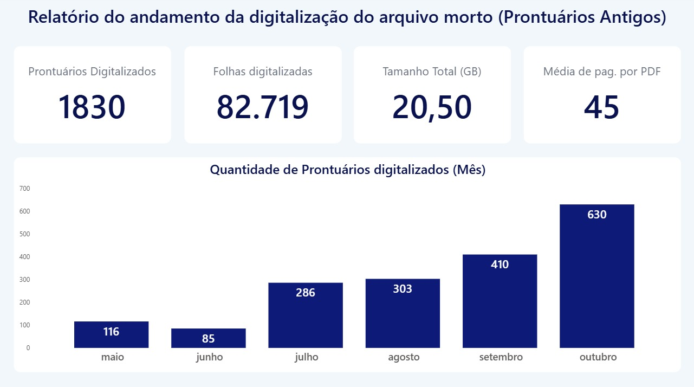
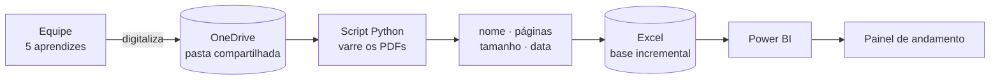

<div align="center">

# Projeto Arquivo Morto

**Um arquivo de papel virando dado — e o dado virando gestão.**

Digitalização do arquivo morto de prontuários de RH, com uma equipe de cinco
aprendizes, um script que lê a pasta na nuvem e um painel que mostra o
andamento em tempo real.




</div>

---

## Sumário

- [O que é](#o-que-é)
- [O problema](#o-problema)
- [Destaques](#destaques)
- [Como funciona](#como-funciona)
- [Resultados](#resultados)

---

## O que é

A empresa mantinha um arquivo morto físico de prontuários de funcionários que
precisava ser digitalizado. Liderei a equipe de cinco aprendizes responsável
pela digitalização; cada um salvava os PDFs numa pasta compartilhada no
OneDrive.

O projeto tem duas metades: a operação de digitalização em si e a camada de
acompanhamento — um script que varre a pasta e um painel do Power BI que
transforma aquele monte de arquivos em números de gestão.

---

## O problema

A pasta compartilhada crescia, mas ninguém sabia **quanto**. Não havia resposta
para perguntas básicas do dia a dia:

| Pergunta | Antes |
|---|---|
| Quantos prontuários já foram digitalizados? | Contagem manual, desatualizada no dia seguinte |
| Quantas páginas isso representa? | Desconhecido |
| O ritmo está subindo ou caindo? | Percepção, não medida |
| Quanto falta? | Estimativa de dedo |

Sem isso, cobrar meta da equipe e prestar conta para a liderança era opinião
contra opinião.

---

## Destaques

### 📊 Painel de acompanhamento

Quatro números no topo respondem o essencial — prontuários digitalizados,
folhas, volume em GB e média de páginas por PDF — e o gráfico mensal mostra a
curva de produção, que é o que de fato se gerencia.

### 🔎 Leitura automática da pasta

O script percorre a pasta compartilhada e extrai de cada PDF o que o painel
precisa:

| Campo | Para que serve no painel |
|---|---|
| Nome do arquivo | Identificação do prontuário |
| Número de páginas | Total de folhas e média por PDF |
| Tamanho em MB | Volume acumulado em GB |
| Data de modificação | Eixo do gráfico mensal |

### ♻️ Processamento incremental

A cada execução, só os PDFs novos entram na planilha. A base cresce em vez de
ser refeita, então rodar de novo é barato mesmo com milhares de arquivos.

### 📈 Gestão por dado

Com a curva mensal visível, a conversa com a equipe deixou de ser sobre esforço
e passou a ser sobre ritmo: dá para ver queda, recuperação e aceleração no mês
em que aconteceram.

---

## Como funciona

**Stack:** Python · PyMuPDF (contagem de páginas) · pandas + openpyxl (planilha)
· Power BI (painel) · OneDrive (pasta compartilhada).



### Rodando

```bash
pip install pymupdf pandas openpyxl
```

Ajuste no topo do script os dois caminhos — a pasta dos PDFs e onde gravar a
planilha — e execute. A planilha resultante é a fonte do painel: basta
atualizar no Power BI.

---

## Resultados

<div align="center">

| Prontuários | Folhas | Volume | Média por PDF |
|:---:|:---:|:---:|:---:|
| **1.830** | **82.719** | **20,50 GB** | **45 páginas** |

</div>

Produção por mês:

| Mês | Prontuários |
|---|---:|
| Maio | 116 |
| Junho | 85 |
| Julho | 286 |
| Agosto | 303 |
| Setembro | 410 |
| Outubro | 630 |

Da virada de junho para outubro a produção mensal cresceu mais de sete vezes —
e, com o painel no ar, dava para enxergar isso acontecendo em vez de descobrir
no fechamento.

- Visibilidade total do andamento, atualizada pela própria operação
- Gestão da equipe baseada em número, não em percepção
- Projeto elogiado pela liderança e reconhecido internamente
